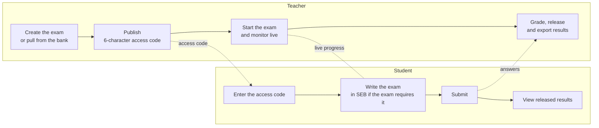
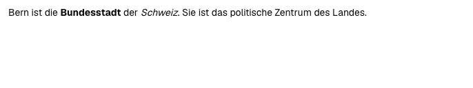
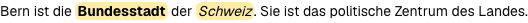
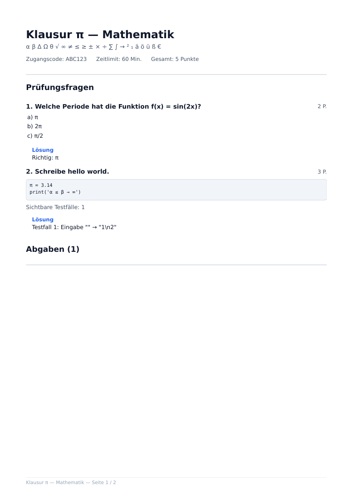

<p align="center">
  <picture>
    <source media="(prefers-color-scheme: dark)" srcset="docs/brand/logo-dark.svg">
    
  </picture>
</p>

# OpenExam

**Open-source, self-hosted examination platform — a privacy-first alternative to Exam.net for
schools.**

OpenExam lets a school run secure digital exams on its own infrastructure: no recurring license
fees, no student data sent abroad, no proprietary client. It covers the full exam lifecycle —
authoring, a reusable question bank, secure delivery inside Safe Exam Browser (SEB), live
monitoring, grading, and result export — on a single small server.

Built as a Maturitätsarbeit (Swiss gymnasium thesis) at Kantonsschule Uetikon am See. Licensed
under the AGPL-3.0.

> **Status: v1.0.0 — stable.** See [`DEPLOYMENT.md`](DEPLOYMENT.md) for production operations,
> [`CHANGELOG.md`](CHANGELOG.md) for what changed, and [`SECURITY.md`](SECURITY.md) for reporting
> vulnerabilities.

[](https://github.com/Foolian2/openexam/actions/workflows/ci.yml)
[](https://github.com/Foolian2/openexam/actions/workflows/security.yml)
[](./LICENSE)
[](CHANGELOG.md)
<br>


**[Highlights](#highlights) · [How an exam works](#how-an-exam-works) ·
[Get started](#get-started) · [Documentation](#table-of-contents) ·
[Contributing](#contributing)**


https://github.com/user-attachments/assets/2bc8a349-ad9e-4867-bd3a-4efe0b22710c


---

## Highlights

- **Locked down in Safe Exam Browser.** For SEB-required exams, every student request (pages,
  API calls, WebSockets) must carry a valid Config Key, checked fail-closed. User-Agent binding
  rejects a mid-exam switch to a plain browser.
  [More ↓](#safe-exam-browser-seb-integration)
- **Nine question types and a question bank.** Multiple choice, true/false, short answer, cloze,
  matching, ordering, rich free text, file upload, and code. Solutions are stripped before
  anything reaches the student. [More ↓](#question-types)
- **Live monitor.** Progress, connection state and integrity signals for every student. Grant
  extra time, lock a session, or close the exam. [More ↓](#live-monitor)
- **Answers survive outages.** Autosave over WebSocket with a REST fallback and a localStorage
  buffer. The deadline is owned by the server, and abandoned sessions are auto-submitted.
  [More ↓](#real-time-delivery--data-safety)
- **Grading built in.** Auto-grading for the objective types, per-question grading across the
  class, rubrics, released results, CSV and PDF export. [More ↓](#grading-results--export)
- **Private by design.** Fully self-hosted, built for the Swiss nDSG and the EU GDPR, with no
  analytics or tracking. [More ↓](#privacy)
- **Accessible.** WCAG 2.1 AA target, OpenDyslexic font, high contrast, and Nachteilsausgleich
  time extensions. [More ↓](#accessibility--nachteilsausgleich)
- **Measured capacity.** 1,600 students and 64 teachers within the latency targets on one
  4 vCPU / 8 GB server. [More ↓](#capacity)

## How an exam works



Teachers work in a normal browser. SEB is opt-in per exam: when a teacher turns it on, students
write the exam inside SEB, which OpenExam launches with a generated `.seb` configuration;
otherwise they write it in a normal browser. Each exam moves through
`DRAFT → PUBLISHED → ACTIVE → CLOSED → GRADED → ARCHIVED` (see [Exam lifecycle](#exam-lifecycle)).

## Get started

**Run it for your school.** On a fresh Ubuntu server with your domain's A record pointing at it:

```bash
git clone https://github.com/Foolian2/openexam.git /opt/openexam && cd /opt/openexam
./openexam install
```

The wizard checks the server, generates secrets, issues the TLS certificate, deploys, and sets up
backups and the firewall. See [Deployment](#deployment) and [`DEPLOYMENT.md`](DEPLOYMENT.md).

**Hack on it locally.** Requires Node 26, pnpm 12 and Docker, on Linux or macOS:

```bash
./openexam install local      # .env with dev secrets, services, migrations, demo data
./openexam dev                # every day after: services up, migrations, pnpm dev
```

See [Quick start (local development)](#quick-start-local-development) for the manual steps and
[`CONTRIBUTING.md`](CONTRIBUTING.md) before opening a PR.

---

## Table of contents

- [Highlights](#highlights)
- [How an exam works](#how-an-exam-works)
- [Get started](#get-started)
- [Why OpenExam](#why-openexam)
- [Features](#features)
- [Architecture](#architecture)
- [Tech stack](#tech-stack)
- [Project structure](#project-structure)
- [Safe Exam Browser (SEB) integration](#safe-exam-browser-seb-integration)
- [Real-time delivery & data safety](#real-time-delivery--data-safety)
- [Security](#security)
- [Privacy](#privacy)
- [Accessibility & Nachteilsausgleich](#accessibility--nachteilsausgleich)
- [Capacity](#capacity)
- [Quick start (local development)](#quick-start-local-development)
- [Testing & CI](#testing--ci)
- [Deployment](#deployment)
- [Configuration reference](#configuration-reference)
- [Contributing](#contributing)
- [License](#license)

---

## Why OpenExam

Commercial exam tools store student data abroad, charge recurring fees, and lock schools into
proprietary clients. OpenExam takes the opposite approach:

| | Commercial tools | OpenExam |
|---|---|---|
| **Cost** | Recurring per-student license | Free (self-hosted) |
| **Data location** | Vendor cloud, often non-EU | Your own server |
| **Source code** | Closed | AGPL-3.0, auditable |
| **Client lockdown** | Proprietary | Safe Exam Browser (ETH Zurich, MPL-2.0) |
| **Vendor lock-in** | High | None — standard Docker Compose stack |

**Explicit non-goals:** AI proctoring (facial recognition, eye tracking), webcam identity
verification, automatic LLM essay grading, native mobile apps, and multi-school SaaS. SEB is a
deterrent against casual cheating, not a cryptographic guarantee of integrity.

| Persona | Primary tasks |
|---------|---------------|
| **Teacher** (Lehrperson) | Create exam → add questions (or pull from the bank) → publish access code → monitor live → grade → release results / export |
| **Student** (Schüler/in) | Enter access code → take the exam in SEB → submit → view released results |
| **Administrator** | Deploy & maintain, manage user roles, review the audit log |

The UI is in German; code and comments are in English.

## Features

### Exam lifecycle

```
DRAFT → PUBLISHED → ACTIVE → CLOSED → GRADED → ARCHIVED
```

- **DRAFT** — editable, invisible to students.
- **PUBLISHED** — access code live; students can join.
- **ACTIVE** — exam running; the teacher monitors live.
- **CLOSED** — submissions locked. Closing auto-submits every still-open session.
- **GRADED** — grading marked complete; results can be released to students.
- **ARCHIVED** — read-only. Teachers can opt in to auto-archiving closed/graded exams after
  30 days.

Each exam gets a unique 6-character access code. Exams can be duplicated, organized into folders,
searched, and given an optional scheduled start/end window that gates joining.

### Question types

Nine types, each with a typed JSON `config` (including the solution) and a matching `answer`
shape — see `prisma/schema.prisma` and `lib/types/`.

| Type | Description | Grading |
|------|-------------|---------|
| `MULTIPLE_CHOICE` | Single- or multi-select | Auto (all-or-nothing on the exact option set) |
| `TRUE_FALSE` | Wahr / Falsch | Auto |
| `SHORT_ANSWER` | Single line, matched against accepted answers, optional case sensitivity | Auto |
| `FILL_IN_THE_BLANK` | Lückentext with multiple accepted answers per blank | Auto (proportional per blank) |
| `MATCHING` | Zuordnung — pair terms with definitions | Auto (proportional per pair) |
| `ORDERING` | Arrange items into the correct sequence | Auto (proportional per position) |
| `FREE_TEXT` | Multiline plain text at any character limit, or rich text (Tiptap); keyword highlighting and rubric checklist while grading | Manual |
| `FILE_UPLOAD` | File upload with configurable extensions and size limit (max 25 MB), stored in Postgres | Manual |
| `CODE` | Monaco editor with starter code and reference test cases (plain textarea if Monaco can't be loaded from the CDN) | Manual |

**Solution stripping:** before a question reaches a student, `sanitizeQuestionConfig`
(`lib/exam-session.ts`) removes correct answers, accepted answers, hidden test cases, and the
`TRUE_FALSE` boolean. `MATCHING` right-side ids are replaced with HMAC-derived opaque ids, and
both the `MATCHING` right-hand side and `ORDERING` items are shuffled with a secret-keyed
permutation (keyed with `MATCHING_ID_SECRET`) — always, even when "shuffle sides" is off — so
neither the ids nor the display order let a student recompute the answer key.



### Question bank

- Personal bank of reusable questions, organized in folders, searchable and filterable.
- Save any exam question to the bank, or add bank items to an exam.
- **Propagate** edits from a bank item into existing copies — only in `DRAFT`/`PUBLISHED`
  exams; active and finished exams are never touched.
- JSON export/import (round-trips, validated per item) and share links that let colleagues copy
  items into their own bank.

### Live monitor

During an exam, teachers see every session in real time over `/ws/monitor/{examId}`:
progress, connection state, submission status, and integrity signals. Actions:

- Grant extra time per student — the standard **Nachteilsausgleich** (+15%, once) or any number of
  minutes — or extend the whole exam.
- Lock / unlock a session.
- Close the exam (auto-submits all remaining sessions).
- Show the SEB quit password for emergencies.

**Integrity signals** (`IntegrityEvent`) are best-effort client-side observations — tab hidden,
window blur, blocked copy/paste/context menu/shortcuts, suspected devtools — plus a SEB Browser
Exam Key change flag. They are surfaced to the teacher, never used to reject a student
automatically.

### Grading, results & export

- Auto-grading on submission for the six objective types; teachers can override any score.
- Grade per student or **per question across all students**, with bulk grading actions,
  rubric checklists, and per-answer feedback.



- Release results to students with one toggle; students then see their answers, points, and
  feedback, and can download their own PDF.
- **CSV export** of results (semicolon-separated, formula-injection safe).
- **PDF printouts** (`@react-pdf/renderer`): the exam, optionally with solution key, plus one
  answer sheet per submitted student. Bundled DejaVu fonts preserve Greek letters and common
  mathematical symbols in questions, solutions, feedback, and code without external font requests.



### Accounts & administration

- Email + password (with email verification), **passkeys**, and optional **Microsoft 365 / Entra
  ID** login.
- **Password reset** by email (`/forgot-password` → `/reset-password`): the link is valid for
  30 minutes, and resetting signs the account out everywhere.
- Sessions slide for 7 days of inactivity but end **30 days after sign-in** at the latest
  (`lib/session-cap.ts`, enforced in Postgres too), so a forgotten login on a shared lab machine
  doesn't live forever.
- Teachers self-register with `TEACHER_ACCESS_CODE`; admins manage roles in the user management
  table.
- First-run onboarding checklist for new teachers.
- **Audit log** for significant actions (exam and question changes, state transitions, grading,
  extensions, locks, exports, SEB denials, quit-password reveals, …), viewable by teachers for
  their own exams and by admins globally, with CSV export.

---

## Architecture

Two stateless backends share one PostgreSQL database and a Redis-protocol store (pub/sub + answer
buffer). Only nginx publishes host ports; Postgres and Redis live on an internal-only Docker
network.

```
                          ┌──────────────────────┐
                          │     nginx :443       │  TLS, /ws/ upgrade, /cap-api/ → Cap
                          └──────────┬───────────┘
          ┌──────────────────┬───────┴──────────────────────────────┐
 ┌────────▼────────┐ ┌───────▼────────┐                   ┌─────────▼───────┐
 │ web :3000 (×N)  │ │ ws-backend:8080│                   │ cap :3000       │
 │ Next.js         │ │ Go             │                   │ CAPTCHA (PoW)   │
 └────────┬────────┘ └───────┬────────┘                   └─────────────────┘
          └─────────┬────────┘
                    │  internal network
     ┌──────────────▼──────┐    ┌─────────────────────┐
     │  postgres :5432     │    │   redis :6379       │
     │  source of truth    │    │  pub/sub + buffer   │
     └─────────────────────┘    └─────────────────────┘
```

**Next.js** is the main application: authentication (Better Auth), all CRUD, server rendering,
the REST API, SEB validation, PDF/CSV generation, and file uploads and downloads. It is stateless and runs
as several replicas behind nginx.

**Go `ws-backend`** only handles WebSocket connections during live exams: answer saves, timer
sync, integrity events, and the teacher monitor. Goroutines handle thousands of persistent
connections cheaply, and a WebSocket failure can never take down the main app. Instances
synchronize exam rooms over Redis pub/sub, so it scales horizontally too.

Teacher actions in Next.js (activate, close, lock, extend, submit) are published on
`exam:{id}:control`; every ws-backend instance subscribes and pushes them to the connected
students and monitors.

**Stateless rules** enforced throughout: no in-memory state; uploaded files only in Postgres (`AnswerFile`), never on a replica's disk; transactions for
critical writes; `@@unique([examId, userId])` on `ExamSession` and `@@unique([sessionId,
questionId])` on `Answer`; idempotency keys on submission.

## Tech stack

| Component | Technology |
|-----------|-----------|
| Web app | Next.js 16 (App Router, `output: "standalone"`), React 19, TypeScript (strict) |
| UI | Tailwind CSS v4, shadcn/ui (Radix, Base UI), Tiptap (rich text), Monaco (code) |
| Auth | Better Auth 1.7 — email/password, passkeys, Microsoft Entra ID, one-time tokens, captcha plugin |
| CAPTCHA | [Cap](https://trycap.dev) — self-hosted proof-of-work |
| Database | PostgreSQL 18 (custom image with wal-g), Prisma 7 with `@prisma/adapter-pg` |
| WebSocket | Go (`coder/websocket`, `pgx`, `go-redis`) |
| Cache / pub-sub | Valkey 9 (Redis-compatible, BSD-licensed) in development, CI and production; `scripts/valkey-migrate.sh` moves an existing Redis 7 volume over |
| Validation | Zod 4 on every API input |
| PDF | `@react-pdf/renderer` |
| Observability | pino JSON logs, Prometheus metrics, Sentry SDK → self-hosted GlitchTip |
| Proxy / TLS | nginx 1.30, certbot (Let's Encrypt) |
| Testing | Vitest, Playwright (+ axe-core), Go `testing` with `-race`, k6 load tests |

## Project structure

```
.
├── app/                     # Next.js App Router
│   ├── (auth)/              # login, register, register-teacher, verify-email,
│   │                        #   forgot-password, reset-password
│   ├── (legal)/             # datenschutz, impressum (filled from LEGAL_* env vars)
│   ├── api/                 # REST routes: exams, questions, question-bank, sessions, folders,
│   │                        #   audit, admin, teacher, health, ready, metrics, monitoring tunnel
│   ├── dashboard/           # admin, student, teacher (exams, monitor, grades, question bank, audit)
│   └── exam/[id]/           # take, complete, launch-seb, seb-enter, quit
├── components/              # React components (shadcn/ui in components/ui, logo in components/brand)
├── hooks/                   # exam/monitor sockets, integrity monitor, …
├── lib/                     # auth, SEB, grading, validators, PDF, audit, encryption, …
├── prisma/                  # schema.prisma + migrations
├── ws-backend/              # Go WebSocket server (internal/: auth, hub, store, seb, protocol, …)
├── nginx/                   # production reverse proxy config
├── infra/                   # postgres image (wal-g), SFTP backup tunnel
├── monitoring/              # Prometheus, Alertmanager, Grafana, blackbox, Vector configs
├── openexam                 # installer & operations CLI (bash; commands live in scripts/cli/)
├── scripts/                 # setup-prod, deploy, rollback, backups, offsite, PITR, pg-upgrade, seeds
├── load/                    # k6 load and stress scenarios
├── __tests__/  e2e/         # Vitest unit tests, Playwright E2E tests
├── docker-compose.yml       # dev dependencies
└── docker-compose.prod.yml  # production stack (+ optional monitoring)
```

---

## Safe Exam Browser (SEB) integration

File-upload questions are available only in exams without SEB. File selection
in SEB does not work reliably. Remove these questions before enabling SEB;
the editor and API block adding or importing them into SEB exams. Existing SEB
exams with file-upload questions cannot be activated until the conflict is resolved.

SEB is ETH Zurich's open-source kiosk browser. OpenExam supports SEB on **Windows and macOS**
(no Linux, Android, Chromebook, or iOS/iPadOS). A teacher can disable the SEB requirement per
exam.

- **Generated `.seb` configs** (`lib/seb-config.ts`): gzip-compressed plist with a `plnd`
  prefix, served by `GET /api/exams/[id]/seb-config` as `application/seb`. The `startURL` embeds
  a single-use launch token, because SEB's first request carries no cookies. URL filters allow
  only the OpenExam host; spell check follows the exam setting.
- **Fail-closed enforcement** (`lib/seb-guard.ts`): for SEB-required exams, every student
  request must carry a valid Config Key token — either the JS API value
  (`SafeExamBrowser.security.configKey`) or the `X-SafeExamBrowser-ConfigKeyHash` header.
  Comparisons are timing-safe. The first valid request binds the token and User-Agent to the
  session, so switching to a plain browser mid-exam is rejected.
- **Browser Exam Key**: each exam pins an `examKeySalt`, making the BEK stable per client. The
  first BEK seen is bound to the session; a change flags the session for the teacher
  (`sebIntegrityFlaggedAt`) rather than locking the student out.
- **WebSocket parity**: the socket authenticates with a first `seb_auth` message (never query
  parameters, which end up in logs); `sebAuthDecision` in `ws-backend/main.go` mirrors the HTTP
  guard exactly.
- **Allowed SEB versions** (optional): `SEB_ALLOWED_VERSIONS` (e.g.
  `Mac.3.7.1.min,Win.3.10.2.min`) makes supporting SEB clients enforce the listed
  platform requirements. Omitted platforms remain unrestricted; older clients may
  ignore the setting. Off by default.
- **Non-SEB fallback**: students without SEB land on `/exam/{id}/launch-seb` with download links
  and a `sebs://` launch link.

SEB's desktop protections are application-level and can be bypassed by a determined technical
user. OpenExam pairs SEB with server-side validation, integrity signals, the audit log, and
teacher supervision. The Config
Key check proves a request was built from the exam's `.seb` file, not that it came from SEB.
Read the [threat model](SECURITY.md#threat-model-and-known-limitations) before using OpenExam for
graded exams, and [`lib/SEB_OUT_OF_SCOPE.md`](lib/SEB_OUT_OF_SCOPE.md) for what is deliberately
not attempted.

## Real-time delivery & data safety

**ws-backend endpoints:** `GET /healthz`, `GET /metrics`, `GET /ws/exam/{sessionId}` (student,
must own the session), `GET /ws/monitor/{examId}` (teacher, must own the exam).

**Answer-saving pipeline:**

```
Student types
  → in-memory buffer, persisted to localStorage (debounced + on beforeunload)
  → 800 ms debounce
  → WebSocket answer:save → ws-backend → Redis buffer → answer:ack
        └─ batch flush to PostgreSQL every 5 s (FLUSH_INTERVAL)
  → no ack within 5 s / socket down → REST fallback: PUT /api/sessions/{id}/answers
  → still failing → stays in localStorage; retried and replayed on reload
```

The client reconnects with exponential backoff (1 s → 30 s). Answers carry a `version` that
increments on every write, plus a client sequence number (`lib/answer-seq.ts`): the REST route and
the Redis flusher only overwrite an answer with an older sequence, so a delayed WebSocket flush
can't clobber a newer REST save. Buffered saves received after submission are dropped, and one
that still lands after grading marks the session `needsRegrade`, so it is regraded before
results are shown, printed, or exported.

**Timing:** the deadline (`effectiveEndTime = start + time limit + extensions`) is owned by the
server; the client countdown is display-only and re-synced via `timer:sync`. At the deadline the
client auto-submits (retrying on failure); the server accepts saves and submissions for a further
30 s grace window (`SUBMIT_GRACE_MS`) and records late submissions as `AUTO_SUBMITTED`. Closing
the exam force-submits every remaining session. If a student never comes back (closed laptop,
crashed browser), a **deadline sweeper** (`lib/deadline-sweeper.ts`) in the web app auto-submits
sessions still open 5 minutes after their deadline, so no exam is left `IN_PROGRESS` forever
(`DEADLINE_SWEEPER_ENABLED`).

**Save authorization:** before ws-backend acknowledges an answer, it checks the session's state in
Postgres, including the active login and browser tab. Saves from a replaced tab, while the teacher
had the session locked, after submission, or after the exam closed are rejected before buffering.
The session row remains locked through the Redis write, so a takeover cannot race past the check.
This runs off the room goroutine, so one slow query doesn't hold up a whole class.

**Device takeover:** opening an exam in another login or tab claims that session. The previous
tab shows a takeover screen with **Hier weiterarbeiten** to reclaim it, and the teacher sees a
replacement counter. A tab keeps its identity across reloads and navigations; a duplicated tab
that inherits it through copied sessionStorage gets a new one, because a Web Lock shows the identity
is still held by a live tab. Unsaved answers are buffered per tab, so a replaced tab's late edits
never overwrite the owner's. REST writes check ownership inside their transaction, and every
WebSocket save checks it in Postgres, so a missed Redis notification cannot authorize old saves.
A locked session can establish ownership while remaining read-only. The counter is advisory:
relaunching SEB after a crash can also replace a login.

| Failure | Effect |
|---------|--------|
| Next.js replica crashes | Other replicas serve; live answer saves go over ws-backend |
| ws-backend crashes | Client falls back to REST saves and reconnects after restart |
| Redis crashes | AOF (`appendfsync everysec`): up to ~1 s of saves can be lost. Saves still unacknowledged are retried from the client's buffer; saves already acknowledged in that window are not, because the client drops its copy on acknowledgement |
| PostgreSQL unavailable | Answers stay in the Redis buffer; flush retries |
| Browser/tab crash | Answers written to localStorage are restored on reload. Edits from the last ~800 ms (the localStorage write debounce) can be lost if the browser or device crashes abruptly |

## Security

| Concern | Mitigation |
|---------|-----------|
| Injection | Prisma parameterized queries; Zod validation on every input |
| XSS | React escaping; rich text sanitized with `sanitize-html`; strict Content-Security-Policy |
| CSRF | SameSite cookies + `Origin` allowlist check (`proxy.ts`, ws-backend); mutating `/api/*` requests without an `Origin` header are rejected |
| Brute force & bots | Redis-backed rate limits shared across instances (5/min per IP on sign-in, sign-up, passkeys), plus per-account limits that survive a school's shared NAT address (10 sign-ins per 15 min, 3 password-reset requests per hour); Cap CAPTCHA on sign-up and sign-in; access-code join requires a signed-in student account and is limited to 10 attempts per minute per account, fail-closed |
| Authorization | Teacher-facing routes (exams, questions, question bank, grading, live monitor) check the teacher/admin role as well as ownership, so a student account can't use them even if it somehow owns the record |
| Sessions | 7-day sliding sessions capped at 30 days absolute; password reset revokes all sessions; open WebSockets close at expiry and re-check their session every 30 s, so a logout or revocation disconnects them at the next check |
| Host-header poisoning | nginx only accepts `OPENEXAM_DOMAIN`; auth links built from pinned `BETTER_AUTH_URL` |
| Secrets at rest | OAuth tokens and SEB quit passwords AES-256-GCM encrypted (`AT_REST_ENC_KEY`) |
| Startup safety | Production refuses to boot with placeholder or too-short secrets |
| File uploads | Size/extension checks (max 25 MB) and a per-session storage budget, stored in Postgres, served as forced downloads (`attachment`, `nosniff`, `CSP: sandbox`) so uploaded HTML/SVG never renders on the app origin |
| Headers | CSP, HSTS (incl. subdomains), `nosniff`, `X-Frame-Options: DENY`, strict referrer policy |
| Logs | nginx logs request lines without their query string, keeping one-time SEB sign-in tokens (`?ott=`) out of the request field (the `Referer` field is still logged) |
| Network | Postgres/Redis on an `internal: true` network; dashboards only via SSH tunnel |
| Exam integrity | SEB Config Key check, User-Agent changes blocked and audit-logged, Browser Exam Key changes flagged to the invigilator, server-owned deadline, idempotent submission, audit trail. SEB checks prove the exam's configuration, not the client: see [Threat model](SECURITY.md#threat-model-and-known-limitations) |
| Supply chain | gitleaks, dependency review, `pnpm audit`, govulncheck, Trivy, Semgrep, Dependabot, digest-pinned images |

Details on scanning and reporting: [`SECURITY.md`](SECURITY.md).

## Privacy

OpenExam is built for the Swiss nDSG and the EU GDPR:

- **Self-hosted** — all data stays on the school's own server. The optional encrypted off-site
  backups go to an SFTP host the school controls.
- **Data minimization** — name, email, role, and exam data. No analytics, no tracking, no
  external fonts; error tracking goes to a self-hosted GlitchTip through the app's own tunnel.
- **Third parties** — no exam or account data is sent to a third party. Two scripts are loaded
  from the jsDelivr CDN: the Cap CAPTCHA widget on the sign-in and registration pages, and the
  Monaco editor for programming questions. jsDelivr therefore sees the visitor's IP address and
  browser, which `/datenschutz` discloses. Microsoft Entra ID login is optional and restricted to
  a single tenant GUID.

Roles follow the school's email domains, set in `SCHOOL_STUDENT_DOMAINS` and
`SCHOOL_TEACHER_DOMAINS` (`lib/school-domains.ts`): addresses on a student domain become students,
on a teacher domain teachers. Microsoft logins with any other address are rejected.

### Datenschutzerklärung, cookies & Impressum

- **`/datenschutz` and `/impressum`** are public pages rendered from a German template
  (`app/(legal)/`). The school is the data controller, so its details come from `LEGAL_*`
  environment variables (see `.env.example`); production refuses to boot without them.
  Sections for Microsoft login and error tracking appear only when those are configured.
- **No cookie banner.** OpenExam only sets cookies and browser storage that are technically
  necessary or remember a user's own setting, and none reach a third party — so no consent is
  required (nDSG; ePrivacy / TTDSG §25(2)). Consent-manager plugins (Cookiebot, Usercentrics,
  …) would add a third-party tracking script on every page. Instead, the privacy page
  lists every cookie and storage key, generated from `lib/legal/storage-inventory.ts`, which
  imports the real key constants from `lib/storage-keys.ts` (a unit test fails if one is
  missing).
- **Acknowledgement at registration.** Both registration forms require ticking "Ich habe die
  Datenschutzerklärung gelesen"; the server enforces it in Better Auth's `user.create` hook,
  stores `User.privacyAcceptedAt` / `privacyPolicyVersion`, and writes a
  `PRIVACY_POLICY_ACCEPTED` audit entry. Microsoft sign-in shows a notice next to the button
  instead. Bump `LEGAL_POLICY_VERSION` when the wording changes.

## Accessibility & Nachteilsausgleich

Target: WCAG 2.1 AA for student-facing views, checked with axe-core in the E2E suite.

- Keyboard navigation, semantic HTML, ARIA labels, visible focus, `prefers-reduced-motion`.
  Reduced motion removes movement but keeps state feedback: loading spinners still turn and
  progress bars still report their value to screen readers.
- The `D` theme shortcut works outside text inputs and editors; typing in Monaco code editors
  does not change the page theme.
- Per-student settings: **OpenDyslexic font**, **high contrast**, **reduced motion**, and **hide
  countdown**; the in-exam settings menu also offers **text size** and light/dark theme.
- **Nachteilsausgleich:** teachers grant +15% of the time limit (once per session) or a custom
  extension from the live monitor; the new deadline is enforced server-side.

## Capacity

### Performance targets

| Metric | Target |
|--------|--------|
| Exam page load | < 2 s (p95) |
| API response | < 200 ms (p95) |
| WebSocket answer save → ack | < 100 ms (p95) |
| Error rate | < 1% |

### Measured

Measured on a **4 vCPU / 8 GB** VM with the full production stack:

| | Result |
|---|---|
| Students inside targets (p95 WS ack < 100 ms, p95 REST < 200 ms, 0% errors) | **1,600 students + 64 teachers** |
| 60-minute soak at 1,600 | No latency drift, no goroutine or memory leak |
| First bottleneck | CPU — memory use stayed around 3 GB even at 4,000 students |
| Past the limit | Latency rises gracefully; no errors, no rejected answers |

The most fragile moment is the exam-start burst, when every student loads the page at once. It
scales with the number of `web` replicas, and three things soften it:

- **Admission queue** (`lib/exam-admission.ts`): first-time joiners are admitted at a fixed rate
  (`EXAM_ADMISSION_RATE_PER_SEC`, default 25/s); everyone else gets a short countdown on the join
  form (at most `EXAM_ADMISSION_MAX_WAIT_SEC`, default 45 s). The exam clock starts on admission,
  so nobody loses time waiting, and a class of 25 never sees the queue. If Redis is down, everyone
  is admitted straight away.
- **Jitter:** status polling, answer retries, and the first WebSocket connect are randomized so a
  class doesn't hit the server in lockstep.
- **Landing page:** `/` is prerendered at build time (the login state is resolved in the
  browser), and nginx micro-caches it for 30 s on top.

The k6 scenarios used for these runs are in [`load/`](load/README.md).

---

## Quick start (local development)

**Prerequisites:** Node 26, pnpm 12 (`corepack enable`), Docker with Compose v2 — on Linux or
macOS. Go is only needed to work on `ws-backend/`.

The guided way, which also offers to install whatever is missing (Docker from Docker's apt
repository on Ubuntu/Debian; Docker Desktop or Colima and Node via Homebrew on macOS):

```bash
./openexam install local      # checks, .env with fresh dev secrets, services, migrations, demo data
./openexam dev                # every day after: services up, pending migrations, pnpm dev
```

`install local` writes a complete development `.env` and is safe to re-run: an existing `.env` is
kept and only missing values are filled in. `./openexam create-teacher --local` adds a verified
teacher/admin login; `./openexam doctor --local` checks the setup.

The same by hand:

```bash
pnpm install
cp .env.example .env                 # generate secrets with: openssl rand -base64 32

# Postgres, Valkey, Cap, and ws-backend — bound to 127.0.0.1 only
docker compose up -d

pnpm exec prisma migrate dev         # apply migrations + generate the client
pnpm dev                             # http://localhost:3000
```

In development (`NODE_ENV=development`) email verification is skipped and verification links are
logged to the console. `DISABLE_RATE_LIMIT` / `DISABLE_CAPTCHA` exist for local testing and are
refused in production.

> Upgrading an old checkout? A `postgres_data` volume from before the Postgres 18 bump won't
> start. Dev data is disposable: `docker compose down -v`, then start again.

| Command | What it does |
|---------|--------------|
| `pnpm dev` / `pnpm build` / `pnpm start` | Dev server (Turbopack) / production build / run it |
| `pnpm lint` / `pnpm typecheck` / `pnpm format` | ESLint / `tsc --noEmit` / Prettier |
| `pnpm test` / `pnpm test:watch` / `pnpm test:coverage` | Vitest |
| `pnpm test:e2e` | Playwright (needs the dev services running) |
| `pnpm test:stress` | Playwright stress suite |
| `pnpm load:*` | k6 load scenarios |
| `pnpm seb:sync-defaults` | Regenerate `lib/seb-default-root-settings.json` |
| `pnpm seb:regenerate-keys` | Recompute stored SEB Config Keys |
| `cd ws-backend && go test -race ./...` | Go tests |

## Testing & CI

- **Unit tests** (`__tests__/`, Vitest) — SEB guard/tokens/config, grading, validators, question
  bank, encryption, CSRF, rate limiting, PDF rendering, and more; coverage thresholds enforced.
- **E2E tests** (`e2e/`, Playwright) — auth and password reset, the student exam flow, teacher
  workflows, onboarding, question bank, schedule gating, accessibility settings, ownership
  checks, race-condition fixes; `e2e/stress/` holds the stress suite.
- **Go tests** — `go test -race ./...` in `ws-backend/`.

**CI** (`.github/workflows/ci.yml`, every push and PR to `master`): secret scan, lint, typecheck
(incl. Prisma validate and schema/migration drift check), unit tests, E2E against real Postgres +
Valkey, Go lint + tests, and a production build.
**Security** (`.github/workflows/security.yml`, push, PR, weekly): dependency review, `pnpm
audit`, govulncheck, Trivy image scans, Semgrep (with custom rules for missing auth, role and
`Origin` checks). `pr-agent.yml` adds an AI review comment on each PR.

---

## Deployment

OpenExam targets a single Linux host running Docker Compose. On a fresh Ubuntu server with the
domain's A record pointing at it:

```bash
git clone https://github.com/Foolian2/openexam.git /opt/openexam && cd /opt/openexam
./openexam install
```

The wizard checks the server (installing Docker if it's missing), asks for the domain, admin
email, the school's details for `/datenschutz` and `/impressum`, and the optional parts (SMTP with
a test mail, Microsoft login, monitoring, encrypted offsite backups, the first admin account).
It then runs the same idempotent `scripts/*.sh` chain as the non-interactive
`./scripts/setup-prod.sh exam.example.com`: it checks DNS, generates `.env.prod` with random secrets,
issues the TLS certificate, creates the Cap site key, deploys, and installs cron jobs (renewal,
backups) and the firewall. Day to day:

| Command | What it does |
|---------|--------------|
| `./openexam update` | `git pull` + `deploy.sh` (build, migrate, roll containers); offers `rollback.sh` if it fails |
| `./openexam status` | Containers, health, TLS, last deploy and backup |
| `./openexam doctor` | Config and host checks (`--smtp` sends a test mail); exits 1 on problems |
| `./openexam backup` / `restore` | Dump now (+ offsite push) / restore a local or offsite dump |
| `./openexam backup-offsite` | Set up encrypted offsite copies of the dumps and `.env.prod` |
| `./openexam create-teacher` | Create a verified teacher/admin login |
| `./openexam uninstall` | Remove the stack (keeps data unless `--purge`) |

`--yes` runs any of them unattended. Without the CLI: `git pull && ./scripts/deploy.sh`, and
`./scripts/rollback.sh` to go back to the previous image tag.

The production stack (`docker-compose.prod.yml`) runs nginx, `web` (**6 replicas**, sized for an
8 vCPU host — lower `deploy.replicas` on smaller machines; 4 is the measured setting for 4 vCPU),
ws-backend, a one-shot `migrate` service, Postgres, Valkey (service name `redis`), Cap, and
certbot.

- **Backups:** daily `pg_dump` (`scripts/backup.sh`), kept on the host for 14 days. Uploaded files
  live in Postgres, so the dump covers them. Copy the dumps off the host (`./openexam backup-offsite`
  does it encrypted, together with `.env.prod`). Optional point-in-time
  recovery with wal-g ships encrypted WAL and base backups to an SFTP host you control
  (`WALG_STORAGE_BACKEND=sftp`); it is off by default — see `DEPLOYMENT.md`'s "Encrypted SFTP
  backups (opt-in)". Setup (`scripts/setup-walg-sftp.sh`, needs only Docker on the host) prints
  an encryption-key recovery sheet you must store off the server; on a rebuilt host,
  `scripts/restore-walg-key.sh` takes the key from that sheet.
- **Monitoring (optional):** `scripts/setup-monitoring.sh` adds Prometheus, Grafana,
  Alertmanager (email alerts), exporters, blackbox probes, and GlitchTip — all self-hosted and
  reachable only through SSH tunnels.
- **Health:** `/api/health` (liveness), `/api/ready` (dependencies), ws-backend `/healthz`.
- **Demo data:** `scripts/seed-demo.ts` creates a demo teacher and student with exams in every
  state (safe to run in production; see the script header).

**Read [`DEPLOYMENT.md`](DEPLOYMENT.md) before your first production deploy.** It covers setup
step by step, rollbacks, monitoring, PITR restore drills, major Postgres upgrades, disaster
recovery, and a local rehearsal without a real domain. Note that `NEXT_PUBLIC_*` values are baked
into the client bundle at build time — changing the domain requires a rebuild (`deploy.sh` does
this).

## Configuration reference

`.env.example` is the fully commented template; `scripts/gen-env-prod.sh` fills it with random
secrets. The most important variables:

| Variable | Purpose |
|----------|---------|
| `DOMAIN` / `OPENEXAM_DOMAIN` | Domain for certbot and the only `Host` nginx accepts |
| `NEXT_PUBLIC_BASE_URL` | Public origin; baked into the client bundle, also read by ws-backend for SEB key checks |
| `BETTER_AUTH_URL` | Pinned auth origin (required in production) |
| `ALLOWED_ORIGINS` | Origin allowlist for API/WS CSRF checks |
| `BETTER_AUTH_SECRET`, `POSTGRES_PASSWORD` | Session signing secret, database password |
| `MATCHING_ID_SECRET` | HMAC key hiding MATCHING/ORDERING solutions (min. 32 chars) |
| `AT_REST_ENC_KEY` | AES-256-GCM key for encrypted-at-rest fields (min. 32 chars) |
| `TEACHER_ACCESS_CODE` | Code required for teacher self-registration (min. 12 chars) |
| `CAP_ADMIN_KEY`, `CAP_SECRET_KEY`, `NEXT_PUBLIC_CAP_WIDGET_ENDPOINT` | Cap CAPTCHA |
| `SMTP_*` | Verification, password-reset, and notification emails |
| `MICROSOFT_CLIENT_ID` / `_SECRET` / `_TENANT_ID` | Optional Entra ID login (tenant must be a GUID) |
| `SEB_ALLOWED_VERSIONS` | Optional minimum SEB client versions |
| `LEGAL_CONTROLLER_NAME`, `LEGAL_CONTROLLER_ADDRESS`, `LEGAL_CONTACT_EMAIL`, `LEGAL_HOSTING_PROVIDER` | The school's details on `/datenschutz` and `/impressum`; required in production. Optional: `LEGAL_DPO_*`, `LEGAL_RETENTION_NOTE`, `LEGAL_BACKUP_PROVIDER`, `LEGAL_POLICY_VERSION` |
| `WALG_STORAGE_BACKEND`, `WALG_SSH_*` | Optional encrypted off-site backups for PITR (`disabled` or `sftp`) |
| `GRAFANA_*`, `GLITCHTIP_*`, `SENTRY_DSN`, `ALERT_EMAIL_TO` | Optional monitoring |
| `DEADLINE_SWEEPER_ENABLED`, `ANSWER_FILE_RETENTION_ENABLED` | Background jobs in `web`: auto-submit abandoned sessions after the deadline, and prune replaced upload attachments of submitted sessions every 10 min. Both default to `true` |

`NEXT_PUBLIC_WS_URL` stays **unset** in production — the browser uses the page origin and nginx
proxies `/ws/`.

---

## Contributing

See [`CONTRIBUTING.md`](CONTRIBUTING.md) for setup, the PR checklist, commit conventions, code
patterns (new endpoints, new question types), and security-sensitive areas. Please report vulnerabilities privately as described in
[`SECURITY.md`](SECURITY.md), and follow the [`CODE_OF_CONDUCT.md`](CODE_OF_CONDUCT.md).

## License

[GNU Affero General Public License v3.0](./LICENSE). Contributors sign the
[Contributor License Agreement](CLA.md) once before their first pull request is merged.
